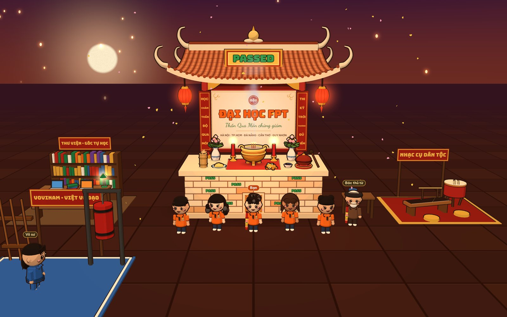
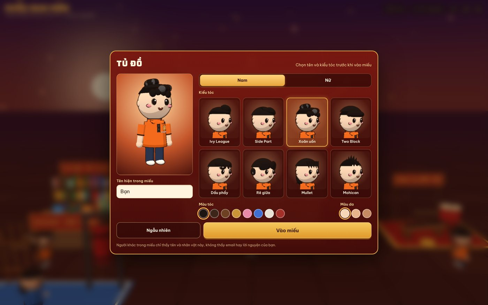
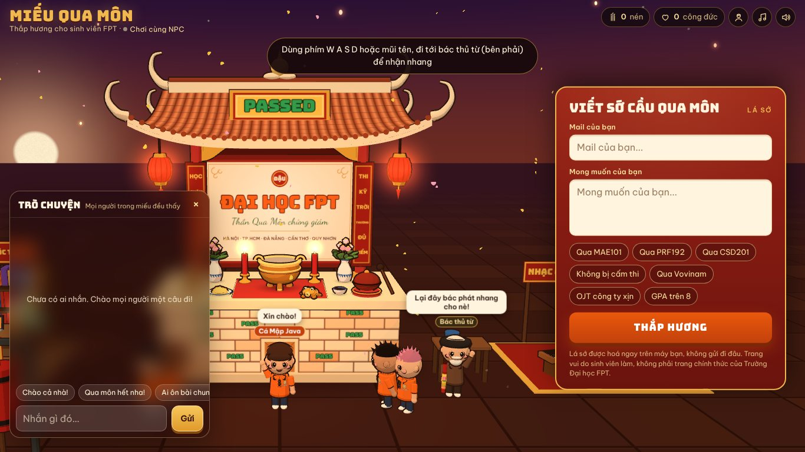
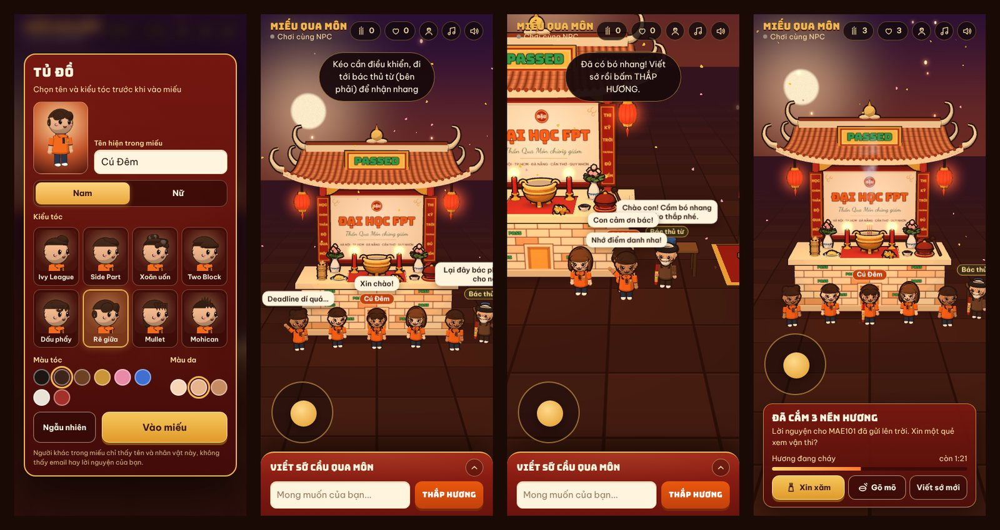

<div align="center">

# Miếu Qua Môn

**Miếu thắp hương 3D nhiều người chơi, chạy thẳng trên trình duyệt.**
Viết sớ, thắp nhang, xin xăm, gõ mõ và trò chuyện cùng bạn bè trong mùa thi.

[**Chơi ngay → mieu-qua-mon.vercel.app**](https://mieu-qua-mon.vercel.app)




</div>

## Giới thiệu

Miếu Qua Môn là một dự án vui cho sinh viên: một ngôi miếu nhỏ dựng hoàn toàn bằng code, nơi mọi người vào cùng lúc, đi lại quanh miếu, thắp nhang cầu qua môn và nói chuyện với nhau. Toàn bộ mô hình, ánh sáng, âm thanh và nhạc nền đều được tạo bằng code, không dùng file 3D, ảnh hay nhạc có sẵn.

> Đây là dự án cá nhân, **không phải** trang chính thức của Trường Đại học FPT.

## Tính năng

| | |
|---|---|
| **Nghi lễ** | Nhận nhang từ bác thủ từ, viết sớ, thắp hương, hoá sớ, đếm giờ hương cháy |
| **Xin xăm** | Nhấn giữ để lắc ống xăm, 24 quẻ kèm lời giải và gợi ý ôn tập theo mã môn (PRF192, MAE101, CSD201…) |
| **Gõ mõ** | Chế độ cận cảnh, chạm hoặc phím Space để gõ, tích công đức và combo |
| **Nhân vật** | Tủ đồ với 16 kiểu tóc nam/nữ, 8 màu tóc, 3 màu da; ảnh xem trước render trực tiếp từ cảnh 3D |
| **Khám phá** | Tự điều khiển bằng WASD/phím mũi tên hoặc cần điều khiển cảm ứng; góc thư viện, nhạc cụ dân tộc, võ đường Vovinam |
| **Nhiều người chơi** | Thấy nhau di chuyển, thấy hành động của nhau theo thời gian thực; NPC tự lấp chỗ khi miếu vắng |
| **Trò chuyện** | Khung chat kính mờ, tin nhắn hiện trên đầu nhân vật, bộ lọc chống quảng cáo |
| **Âm thanh** | Chuông, mõ, lửa, đàn tranh và nhạc nền ngũ cung tổng hợp bằng Web Audio API |

<p align="center">
  
  
</p>
<p align="center"></p>

## Kỹ thuật

**Đồ hoạ**
- Three.js r170, nạp dạng ES module từ CDN; không bundler, không framework UI.
- Toon shading với gradient map 3 bậc và viền nét bằng *inverted hull* (shader riêng, dùng pháp tuyến đã làm mượt).
- Hình học tĩnh được gộp theo vertex color để giảm draw call; chữ, bảng hiệu, gạch ngói vẽ bằng `CanvasTexture`.
- Khói nhang, cánh hoa, đèn trời và tia lửa là hệ hạt chạy trên GPU.
- Camera tự căn khung theo phần màn hình bị UI che (`setViewOffset`), có bộ khung riêng cho màn dọc.
- Tự hạ độ phân giải khi FPS thấp; có đường dự phòng khi trình duyệt không hỗ trợ WebGL.

**Nhiều người chơi**
- Lớp mạng thử lần lượt: `room` của claude.ai → WebSocket riêng (`server/server.mjs`) → MQTT qua WebSocket tới broker công khai → `BroadcastChannel` giữa các tab.
- Mỗi người chỉ phát trạng thái nhỏ gọn: tên, ngoại hình, vị trí, hành động gần nhất. Gửi tối đa 4 lần/giây, kèm nhịp duy trì 4 giây; ai im lặng quá 11 giây bị xem là đã rời đi.
- Mọi dữ liệu nhận về đều được kiểm tra kiểu và giới hạn giá trị trước khi dùng.

**Chống spam trong chat**
- Lọc ngay tại máy nhận, nên tin rác không hiện với ai kể cả khi người gửi sửa code.
- Chặn số điện thoại (kể cả viết tách hoặc bằng chữ), đường link, tên miền và từ khoá quảng cáo dịch vụ sau khi bỏ dấu và chuẩn hoá ký tự lách luật.
- Giới hạn tần suất theo từng người, bỏ tin trùng, tự ẩn người gửi quảng cáo lặp lại, nút ẩn thủ công.

**Riêng tư**
- Email và lời nguyện chỉ xử lý trên máy người dùng, không gửi đi đâu.

## Cấu trúc

```
src/
  app.js         toàn bộ logic: cảnh 3D, nhân vật, camera, âm thanh, mạng, giao diện
  style.css      giao diện (desktop, điện thoại dọc/ngang, giảm chuyển động)
  markup.html    khung HTML
build.mjs        ghép src/ thành dist/index.html (một file, tự chạy được)
scripts/
  bundle.mjs     tạo bản rút gọn cho CDN: dist/cdn/{a.js, s.css, b.js}
server/
  server.mjs     máy chủ Node nhỏ: phục vụ trang + kênh WebSocket /mq-ws
docs/            ảnh chụp màn hình
```

## Chạy trên máy

Yêu cầu Node.js 18 trở lên.

```bash
npm install
npm run build      # tạo dist/index.html
npm start          # http://localhost:3000 (kèm multiplayer qua WebSocket)
```

Chỉ cần xem giao diện thì mở thẳng `dist/index.html` qua bất kỳ static server nào.

## Triển khai

- **Static (Vercel, Netlify, GitHub Pages):** đưa `dist/index.html` lên là chạy. Nhiều người chơi hoạt động qua MQTT công khai, không cần server.
- **Server riêng (Render, Railway, VPS):** `npm start`. Trang tự nhận kênh WebSocket của server, ổn định hơn và không phụ thuộc broker bên ngoài.

Các tuỳ chọn nằm trong `CONFIG` ở đầu `src/app.js`: thời gian hương cháy, địa chỉ WebSocket, danh sách broker MQTT, ảnh huy hiệu áo.

## Ghi chú

- Logo và tên Trường Đại học FPT thuộc về chủ sở hữu. Huy hiệu trên áo nhân vật là hình vẽ riêng của dự án.
- Phông chữ: Be Vietnam Pro, Bungee, Dancing Script (Google Fonts, SIL Open Font License).
